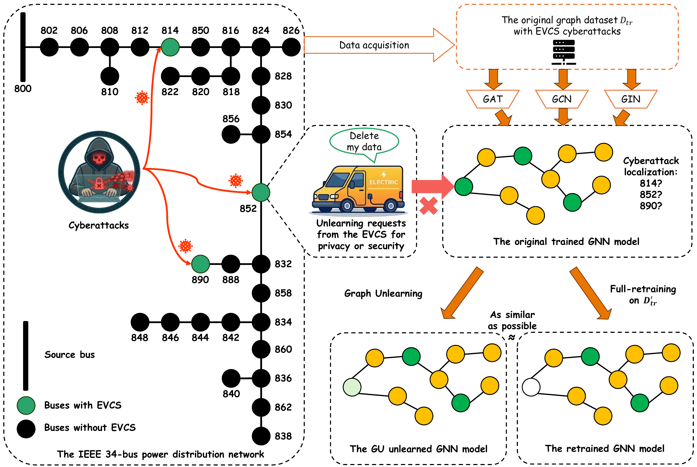

# What Graph Unlearning Cannot Erase: Physics-Induced Leakage of Cyberattack Information in Electric Vehicle Charging Networks

Code for the paper:

> N. Liu, M. Sun, and J. Zhang, "What Graph Unlearning Cannot Erase: Physics-Induced Leakage of Cyberattack Information in Electric Vehicle Charging Networks," submitted to *IEEE Transactions on Smart Grid*, 2026.

---

## Overview

A graph neural network (GNN) localizes charge manipulation attacks on electric vehicle charging stations (EVCSs) from daily feeder snapshots, as graph-level multi-label classification over the EVCS buses. The distribution system operator (DSO) keeps the bus voltages, and each EVCS operator can withdraw the charging power it shares. A withdrawal zeros the charging power at the requested stations and keeps the voltages and the topology, which makes it a feature-level graph unlearning problem. Scenarios $\mathrm{S}_1, \dots, \mathrm{S}_K$ withdraw the first $j$ stations.

The withdrawal leaves a **physical leakage floor**. An attack shifts the voltages of electrically coupled buses, so a GNN retrained without the withdrawn power still localizes attacks at the forgotten stations well above random guessing. Each unlearning method is therefore judged by how close it comes to full retraining (FR), not to random guessing.

<p align="center">
  
</p>
<p align="center"><em>The framework of graph unlearning for EVCS cyberattack localization.</em></p>

| Method | Approach |
|---|---|
| **Original** | Model trained on the full data |
| **Full retraining (FR)** | Training from scratch on the modified data |
| **Fine-tuning (FT)** | Continued training of the original model on the modified data, for 10, 25, 50, or 100 epochs or to convergence |
| **GIF** | Influence-function update with Hessian-vector products |
| **IDEA** | Certified influence-function update, as implemented in OpenGU, with the noise that its certificate requires |

The backbones are GCN, GAT, and GIN, each with three convolution layers, mean and max pooling, a localization head, and an auxiliary attack-type head.

---

## Setup

Python 3.10, CUDA 12.1.

```bash
pip install torch==2.5.1+cu121 --index-url https://download.pytorch.org/whl/cu121
pip install torch-scatter==2.1.2 torch-sparse==0.6.18 \
            torch-cluster==1.6.3 torch-spline-conv==1.2.2 \
            -f https://data.pyg.org/whl/torch-2.5.1+cu121.html
pip install -r requirements.txt
```

---

## Data

Raw data is **not tracked by Git**. Source: the EVCS cyberattack dataset of the [PowerBench benchmark](https://zenodo.org/records/15401290) (Uddin et al., 2026).

| | 34-bus | 123-bus | 8500-node |
|---|---|---|---|
| Buses $N$ / lines $M$ | 37 / 36 | 132 / 131 | 4,876 / 4,874 |
| Graph instances | 2,000 | 4,000 | 1,000 |
| EVCS buses $K$ | 3 | 5 | 7 |
| Unlearning scenarios | S1–S3 | S1–S5 | S1, S7 |
| Backbones | GAT, GCN, GIN | GAT, GCN, GIN | GCN, GIN |

Each node feature stacks the 288 five-minute samples of the bus voltage and of the charging power over the day, $\mathbf{x}_v \in \mathbb{R}^{576}$. The charging power is nonzero only at EVCS buses, and both parts are standardized with scalers fit on the training set.

Download `EVCS Attacks.zip` from the Zenodo record and unzip it. The data folder is the one that holds `34_bus/`, `123_bus/`, and `8500_bus/`. By default the code looks for it at `../Source/PB_data/3_EVCS Attacks`, next to this repository. Elsewhere, pass it as `--data-dir` to `scripts/train.py` and `scripts/e10_seen_floor.py`, set `EVCS_DATA` for `scripts/compute_e9.py`, and set `DATA_DIR` in the first cell of `notebooks/Paper_Figures.ipynb`.

---

## Repository layout

| Path | Content |
|---|---|
| `src/` | Data loading, GNN backbones, training, unlearning methods, voltage noise |
| `config/` | One YAML file per feeder |
| `scripts/train.py` | Runs the methods for one feeder, backbone, and seed, over the scenarios |
| `scripts/analysis_*.py`, `scripts/e10_seen_floor.py`, `scripts/compute_e9*.py` | Collect the runs into the tables behind the figures |
| `scripts/make_tables.py` | Tables III and IV of the paper and the statistics in the text |
| `notebooks/Paper_Figures.ipynb`, `notebooks/fig_style.py` | Figs. 2 to 9 of the paper |

Every script writes under `results/`, which Git ignores. The analysis scripts read the runs from the `--out-dir` folders given below.

---

## Reproducing the paper

### 1. Runs

`scripts/train.py` trains the original model of a trial (feeder, backbone, seed), applies every requested method (`--arms`) to each scenario, and appends one row per scenario and method to `*_raw.csv` in `--out-dir`. `--cache-dir` keeps the original and retrained models, so a later run with the same cache reuses them. Without `--scenario`, all scenarios of the feeder run. The 34-bus and 123-bus feeders use GAT, GCN, and GIN; the 8500-node feeder uses GCN and GIN.

| Runs | Settings |
|---|---|
| Main comparison | `--out-dir results/comparison/main_<bus>`, `--arms Original Mask_only GIF IDEA_cert Finetune_pure WarmStart Retrain Retrain_b` |
| FT epochs | `--out-dir results/ft_epochs/main_<bus>`, `--arms FTpure_e10 FTpure_e50 FTpure_e100` |
| Voltage noise | `--out-dir results/noise/<bus>_clean` without noise, or `results/noise/<bus>_snr<d>` with `--voltage-noise-db <d>` for d = 20, 10, and 0, `--arms Original Mask_only GIF Finetune_pure FTpure_e50 FTpure_e100 Retrain Retrain_b` |
| 8500-node feeder | `--out-dir results/8500node/main_8500bus`, `--bus 8500bus`, scenarios S1 and S7, the arms of the main comparison and of FT epochs |
| Sequential requests | `--out-dir results/sequential/<bus>`, `--sequential`, `--arms Original Mask_only Finetune_pure FTpure_e100 GIF_FT Retrain Retrain_b` |
| One-shot FT | `--out-dir results/sequential/oneshot_<bus>`, without `--sequential`, `--arms FTpure_e75` (34-bus) or `FTpure_e75 FTpure_e125` (123-bus), as many epochs as FT 25 gets over three or five sequential requests |
| Unseen attack types | `--out-dir results/unseen_types/<bus>_h<t>`, GCN, `--holdout-attack-type <t>` for t = 1 to 4; 34-bus S1 to S3 with `--arms Original Mask_only Finetune_pure FTpure_e100 WarmStart Retrain Retrain_b`, 123-bus S1 to S5 with `--arms Original Mask_only Retrain Retrain_b` |
| Cost | `--out-dir` `quiet_<bus>` next to `main_<bus>` in `comparison`, `ft_epochs`, and `8500node`, scenario S1, one process per GPU and nothing else on it |

For example, one trial of the main comparison:

```bash
python scripts/train.py --bus 34bus --backbone GCN --seed 42 --readout station --save-outputs \
    --arms Original Mask_only GIF IDEA_cert Finetune_pure WarmStart Retrain Retrain_b \
    --out-dir results/comparison/main_34bus --cache-dir results/comparison/cache_34bus \
    --data-cache results/comparison/data_cache
```

`--data-cache` stores the loaded data once, and `scripts/compute_e9.py`, `scripts/compute_e9_joint.py`, and `scripts/e10_seen_floor.py` read it from this folder. `Finetune_pure` is FT with 25 epochs, `FTpure_e<n>` FT with n epochs, `WarmStart` FT to convergence, `GIF_FT` GIF followed by FT 25, `Mask_only` the original model with the withdrawn power removed and no update, and `Retrain` full retraining.

### 2. Analysis

```bash
python scripts/analysis_ft.py                    # FT epochs, results/ft_epochs/e3ft_budget_trials.csv
python scripts/analysis_figB.py                  # Fig. 4, results/floor_methods
python scripts/e10_seen_floor.py --bus 34bus --scenarios S1 S2 S3
python scripts/e10_seen_floor.py --bus 123bus --scenarios S1 S2 S3 S4 S5
python scripts/analysis_e4e10.py                 # Figs. 8 and 9, results/sequential_unseen
python scripts/compute_e9.py                     # Figs. 5 to 7 and the LinDistFlow check, results/leakage
python scripts/compute_e9_joint.py               # logistic regression on all bus voltages, Sec. III-B
```

`e10_seen_floor.py` scores FR of the main comparison on the normal graphs and the graphs of one attack type, the reference of Fig. 8 for a type seen in training.

### 3. Tables

```bash
python scripts/make_tables.py
```

`results/tables/tables.txt` holds every number of the text, and `results/tables/tex/` holds Tables III and IV. With `--letter`, the script also prints the analyses of the response to the reviewers, which need further runs.

### 4. Figures

Run `notebooks/Paper_Figures.ipynb` from the `notebooks/` folder. It writes Figs. 2 to 9 to `results/paper_figures/`.

---

## References

- M. J. Uddin, R. A. Jacob, D. R. Olojede, N. Liu, B. Coskunuzer, and J. Zhang. "PowerBench: A Benchmark Suite for Monitoring and Security in Distribution Systems." *Journal of Data-centric Machine Learning Research*, 2026. Dataset: [10.5281/zenodo.15401290](https://zenodo.org/records/15401290)
- J. Wu et al. "GIF: A General Graph Unlearning Strategy via Influence Function." *WWW 2023*.
- Y. Dong et al. "IDEA: A Flexible Framework of Certified Unlearning for Graph Neural Networks." *KDD 2024*.
- B. Fan et al. "OpenGU: A Comprehensive Benchmark for Graph Unlearning." 2025.
