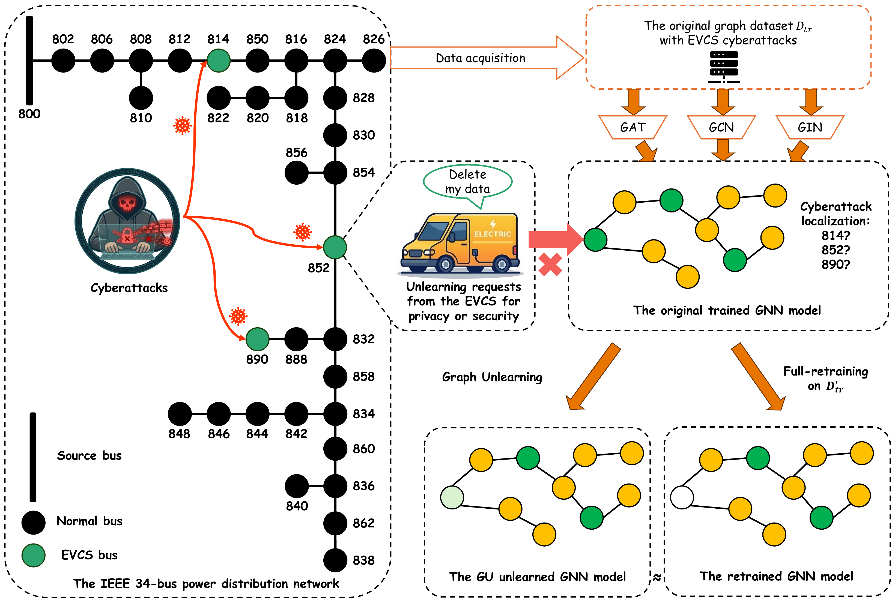

# What Graph Unlearning Cannot Erase: Physics-Induced Leakage of Cyberattack Information in Electric Vehicle Charging Networks

Code for the paper:

> N. Liu, M. Sun, and J. Zhang, "What Graph Unlearning Cannot Erase: Physics-Induced Leakage of Cyberattack Information in Electric Vehicle Charging Networks," submitted to *IEEE Transactions on Smart Grid*, 2026.

---

## Overview

A graph neural network (GNN) localizes charge manipulation attacks on electric vehicle charging stations (EVCSs) from daily feeder snapshots, as graph-level multi-label classification over the EVCS buses. The distribution system operator (DSO) keeps the bus voltages, and each EVCS operator can withdraw the charging power it shares. A withdrawal zeros the charging power at the requested stations and keeps the voltages and the topology, which makes it a feature-level graph unlearning problem. Scenarios $\mathrm{S}_1, \dots, \mathrm{S}_K$ withdraw the first $j$ stations.

The withdrawal leaves a **physical leakage floor**. An attack shifts the voltages of electrically coupled buses, so a GNN retrained without the withdrawn power still localizes attacks at the forgotten stations well above random guessing. Each unlearning method is therefore compared with a second retraining under another seed rather than with random guessing.

<p align="center">
  
</p>
<p align="center"><em>The framework of graph unlearning for EVCS cyberattack localization.</em></p>

| Method | Approach |
|---|---|
| **Original** | Model trained on the full data |
| **Full retraining (FR)** | Training from scratch on the modified data |
| **Fine-tuning (FT)** | Continued training of the original model on the modified data, for 10, 25, 50, or 100 epochs or to convergence |
| **GIF** | Influence-function update with Hessian-vector products |
| **IDEA** | Certified influence-function update |

The backbones are GCN, GAT, and GIN, each with three convolution layers, mean and max pooling, a localization head, and an auxiliary attack-type head.

---

## Setup

Python 3.10, CUDA 12.1.

```bash
pip install torch==2.5.1+cu121 --index-url https://download.pytorch.org/whl/cu121
pip install torch-scatter==2.1.2 torch-sparse==0.6.18 \
            torch-cluster==1.6.3 torch-spline-conv==1.2.2 \
            -f https://data.pyg.org/whl/torch-2.5.1+cu121.html
pip install -r requirements.txt
```

---

## Data

Raw data is **not tracked by Git**. Source: the EVCS cyberattack dataset of the [PowerBench benchmark](https://zenodo.org/records/15401290) (Jacob et al., 2025).

| | 34-bus | 123-bus | 8500-node |
|---|---|---|---|
| Buses $N$ / lines $M$ | 37 / 36 | 132 / 131 | 4,876 / 4,874 |
| Graph instances | 2,000 | 4,000 | 1,000 |
| EVCS buses $K$ | 3 | 5 | 7 |
| Unlearning scenarios | S1–S3 | S1–S5 | S1, S7 |
| Backbones | GAT, GCN, GIN | GAT, GCN, GIN | GCN, GIN |

Each node feature stacks the 288 five-minute samples of the bus voltage and of the charging power over the day, $\mathbf{x}_v \in \mathbb{R}^{576}$. The charging power is nonzero only at EVCS buses, and both parts are standardized with scalers fit on the training set.

---

## References

- R. A. Jacob, M. J. Uddin, D. R. Olojede, B. Coskunuzer, and J. Zhang. "PowerBench: A Benchmark Suite for Monitoring and Security in Distribution Systems." 2025. DOI: [10.5281/zenodo.15401290](https://zenodo.org/records/15401290)
- J. Wu et al. "GIF: A General Graph Unlearning Strategy via Influence Function." *WWW 2023*.
- Y. Dong et al. "IDEA: A Flexible Framework of Certified Unlearning for Graph Neural Networks." *KDD 2024*.
- B. Fan et al. "OpenGU: A Comprehensive Benchmark for Graph Unlearning." 2025.
